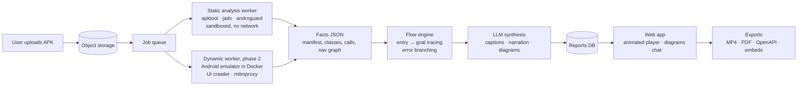

# GlassBoxAPK — Animated system design explainer for Android apps

> **Upload an APK. Watch how it works.**

Status: idea / pre-PRD · Last updated: 2026-10-20

---

## 1. One-line pitch

A web app where a user uploads an Android APK and gets an **animated, step-by-step explanation of the app's system design**. It covers every important user flow, background flow and error path. Each step is linked to the real class, file or API call it came from.

## 2. USP: system design explainer

Existing tools tell you **what is inside** an APK. This one shows **how the app actually works**.

| Others give you | We give you |
|---|---|
| Decompiled code (jadx) | A narrated, animated walkthrough of each flow |
| Security findings (MobSF) | A system design diagram you can zoom into, layer by layer |
| SDK and tracker lists (Exodus, AppBrain) | All possible flows, including error and edge paths |
| Static text reports | Exportable MP4 videos and shareable embeds |

Every animated step carries a **code reference** (for example `LoginViewModel.login()`, `AuthApi (Retrofit)`, `nav_graph.xml: login → home`) and a **confidence label**: *verified* (seen at runtime) or *inferred* (found only in the code). That traceability is what makes it an explanation rather than a guess.

## 3. Who it's for

| User | Why they need it |
|---|---|
| Developers inheriting a legacy app | Understand the codebase in hours instead of weeks |
| Companies that lost source code or their original developer | Recover documentation and plan a rebuild |
| Agencies and freelancers | Estimate a rebuild or takeover accurately |
| QA teams | Get every flow, including error paths, as a test checklist |
| Security and compliance teams | See where data goes and which third parties receive it |
| PMs and founders | Study how a product is put together |
| Investors (technical due diligence) | Judge the quality of an app's architecture quickly |
| Students and learners | Learn real-world app architecture by watching it run |

## 4. Core experience

1. **Upload** an APK (later: AAB, IPA).
2. **Overview**: tech stack, SDKs, permissions, and the high-level system diagram (device ↔ app layers ↔ inferred backend ↔ third parties).
3. **Flow library**: every detected flow, grouped:
   - Happy paths (login, sign-up, browse, checkout, …)
   - Error and edge paths (token expired, payment failed, offline, permission denied, …)
   - Background flows (push handling, sync jobs, WorkManager tasks)
   - Third-party calls (analytics, payments, ads, crash reporting)
4. **Animated player**: pick a flow and press play. A packet travels between components, and each step shows:
   - a plain-language caption
   - a step type: request, response, local storage, or error
   - a code reference and a confidence label
   - controls: play/pause, step back/forward, speed
5. **Zoom levels**: system view → component view (screen, ViewModel, repository, DB, API) → code view.
6. **Ask about a step**: "Why does it retry here?" is answered from the decompiled code (RAG).
7. **Export**: MP4 (with voiceover), GIF, Mermaid/PNG diagrams, Markdown/PDF report, OpenAPI spec.

### Example flow trace (what the animation plays)

```json
{
  "flow": "Login",
  "group": "happy_path",
  "entry": "LoginActivity",
  "goal": "HomeFragment shown with valid session",
  "steps": [
    { "from": "user",   "to": "screen", "type": "request",  "text": "User enters phone and OTP",            "ref": "LoginActivity",               "confidence": "verified" },
    { "from": "screen", "to": "vm",     "type": "request",  "text": "Continue calls login()",                "ref": "LoginViewModel.login()",      "confidence": "inferred" },
    { "from": "repo",   "to": "api",    "type": "request",  "text": "POST /v1/auth/verify",                  "ref": "AuthApi (Retrofit)",          "confidence": "verified" },
    { "from": "api",    "to": "repo",   "type": "response", "text": "JWT + refresh token returned",          "ref": "TokenResponse",               "confidence": "verified" },
    { "from": "repo",   "to": "db",     "type": "storage",  "text": "Tokens saved to encrypted storage",     "ref": "EncryptedSharedPreferences",  "confidence": "inferred" },
    { "from": "vm",     "to": "screen", "type": "response", "text": "Navigate to Home",                      "ref": "nav_graph.xml: login → home", "confidence": "inferred" }
  ]
}
```

A single animation engine plays any trace, so a new flow never needs new animation work.

## 5. How "all possible flows" works

If you list every path through the app's screens you get a combinatorial explosion that nobody can use. Instead, a **flow is defined as one entry point → one goal**:

1. **Entry points**: launcher activity, deep links / intent filters, push handlers, widgets, share targets, background workers (all from `AndroidManifest.xml` and the code).
2. **Goals**: meaningful outcomes such as a successful network write, a payment result, an order created, logout, or a key screen reached.
3. **Trace each entry → goal** through the layers: screen → ViewModel/presenter → repository/use case → API client or local DB → response back.
4. **Branch the error and edge paths** at every step: catch blocks, HTTP 401/4xx/5xx handlers, authenticators and retry logic, offline fallbacks, permission denials.
5. **Check against a real run** (phase 2): an emulator crawls the UI and captures network traffic. Steps it observes become *verified*; steps found only in the code stay *inferred*.
6. **Group and rank** flows by importance (how many paths lead to them and whether they involve money or auth) so the most important flows are shown first.

## 6. Full feature list

### Explainer (the USP)
- Auto-generated system design diagram (C4-style: context → container → component)
- Flow library with happy, error, background and third-party groups
- Animated flow player with captions, code references and confidence labels
- Zooming in and out between levels
- LLM narration in **beginner** and **senior engineer** modes
- Voiceover and MP4/GIF export (reusing the existing Kokoro + HTML→MP4 pipeline from the Knit videos)
- Shareable links and embeddable players (README, Notion, PR descriptions)
- "Ask about this step" chat grounded in the decompiled code

### Supporting analysis
- Tech stack detection: Kotlin/Java, Flutter, React Native, Unity, Xamarin/.NET MAUI, Cordova/Ionic
- SDK and third-party inventory, with what each SDK does
- Screen inventory and navigation graph, with screenshots from the crawl
- Inferred API spec (OpenAPI) from Retrofit/OkHttp code and captured traffic
- Data model: Room/SQLite tables, DTOs, shared-preference keys
- Security and privacy checks: OWASP MASVS basics, hardcoded secrets, risky permissions, mismatches with the Play Data Safety form
- APK size breakdown and unused resources

### Power features (later)
- **Flow diff between versions**: new, changed and removed steps highlighted inside the animation
- Side-by-side comparison of two apps
- Test generation: flows exported as Maestro / Appium scripts
- CI integration: a GitHub Action posts the flow diff on every PR
- Migration starter: generate a Flutter/React Native skeleton from the flow map (own apps only)
- iOS (IPA) support

## 7. How the product itself is built



| Layer | Suggested tech |
|---|---|
| Frontend | React / Next.js, SVG + GSAP or Framer Motion for animation, ELK.js for auto-layout, React Flow for the zoomable graph |
| API | Node (TypeScript) or Python FastAPI |
| Analysis workers | Python: androguard, apktool, jadx (CLI), custom tracers |
| Dynamic analysis | Docker Android emulator (redroid / docker-android), UI crawler (DroidBot-style), mitmproxy |
| LLM | Claude, for flow naming, captions, narration, Q&A over code summaries |
| Storage | Postgres (reports, flows), S3-compatible object storage (APKs, screenshots), vector store for code RAG |
| Video export | Headless Chrome recording the player, then ffmpeg; Kokoro TTS for voiceover |

## 8. Hard problems and risks

| Risk | Mitigation |
|---|---|
| Malicious APK uploads | Every job runs in a throwaway sandbox with no network access (except the controlled dynamic run); size limits; files deleted after processing |
| Obfuscation (R8/ProGuard) | Rely on framework annotations, string constants, resource names and runtime traces; mark confidence lower |
| Flutter (Dart AOT) and React Native Hermes bytecode | Lean on the dynamic crawl and traffic for these; static support comes later |
| Certificate pinning blocks traffic capture | Fall back to static API inference; mark endpoints *inferred* |
| Flow explosion | Entry → goal definition, grouping and importance ranking (section 5) |
| LLM hallucination | The LLM only describes facts the analysers extracted; every step must carry a code reference; confidence labels |
| Legal (reverse engineering third-party apps) | Position it as a tool for studying app design; show analysis, not decompiled source; no one-click cloning of third-party apps |
| Cost of LLM and emulator runs | Cache by APK hash; static analysis is cheap; dynamic analysis only on paid tiers |

## 9. Existing tools

| Tool | What it covers | Gap |
|---|---|---|
| jadx / apktool | Raw decompiled code and resources | No explanation, no flows |
| MobSF | Security analysis | No architecture or flow view |
| Exodus Privacy | Tracker detection | Narrow scope |
| AppBrain / 42matters | SDK intelligence | No per-app flow understanding |
| Appetize | Runs apps in the browser | No analysis |

Nobody offers **animated, code-linked system design explanations**. That gap is the position.

## 10. Roadmap

### MVP: prove the USP
- Native Kotlin/Java APKs, static analysis only
- Tech stack, SDK list, permissions
- Auto-generated system design diagram
- 5–10 main flows plus their error paths
- Animated player (play, step, speed, captions, code references)
- MP4 export of a single flow
- Free tier with an upload size limit

### Phase 2: depth and trust
- Emulator crawl with screenshots, so steps become *verified*
- Traffic capture → OpenAPI spec
- "Ask about this step" chat
- Voiceover narration, shareable links and embeds
- Version diff

### Phase 3: breadth and teams
- Flutter, React Native, Unity support
- IPA (iOS)
- CI / GitHub Action, test generation
- Team workspaces, private reports, due-diligence report pack

## 11. Business model (initial thoughts)

| Tier | Includes |
|---|---|
| Free | Small APKs, static analysis, 3 flows, watermarked export |
| Pro (individual) | All flows, MP4 export with voiceover, chat, version diff |
| Team | Shared workspace, CI integration, private embeds |
| Enterprise / due diligence | Dynamic analysis, security pack, on-prem or VPC deployment |

## 12. Success metrics for the MVP

- An uploaded APK reaches its first animated flow in under 5 minutes
- At least 80% of flow steps carry a code reference
- Users play at least 3 flows per report
- Share rate: percentage of reports with at least one exported video or link

## 13. Open questions

- Product name and domain
- Web only at first, or also a CLI for developers?
- Free-tier limits (APK size, number of flows)
- How much dynamic analysis to include in the MVP, if any
- Hosting and sandbox approach (own servers or cloud containers)

---

*Next step: pick a name, then turn this into a PRD and architecture plan and start building the MVP.*
