<p align="center">
  <picture>
    <source media="(prefers-color-scheme: dark)" srcset="docs/readme/banner-dark.svg">
    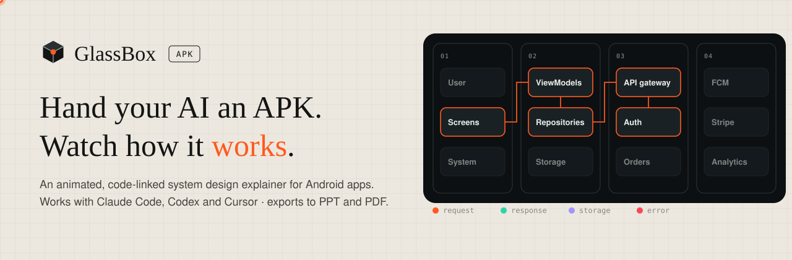
  </picture>
</p>

<p align="center">
  <a href="https://glassboxapk.vercel.app"></a>
  <a href="https://glassboxapk.vercel.app/app.html#/sample/flows"></a>
  <a href="docs/readme/fooddash-deck.pptx"></a>
  <a href="docs/readme/fooddash-report.pdf"></a>
</p>

<p align="center">
  
  
  
  
  
  
  
</p>

<p align="center">
  <b><a href="#-see-it-in-action">Demo</a></b> ·
  <b><a href="#-how-it-works">How it works</a></b> ·
  <b><a href="#%EF%B8%8F-the-explainer">The explainer</a></b> ·
  <b><a href="#-export-to-ppt-and-pdf">Export</a></b> ·
  <b><a href="#-quick-start">Quick start</a></b> ·
  <b><a href="#-what-your-agent-runs">Agent workflow</a></b> ·
  <b><a href="#-faq">FAQ</a></b>
</p>

---

## 🎬 See it in action

<p align="center">
  <a href="docs/readme/demo.mp4">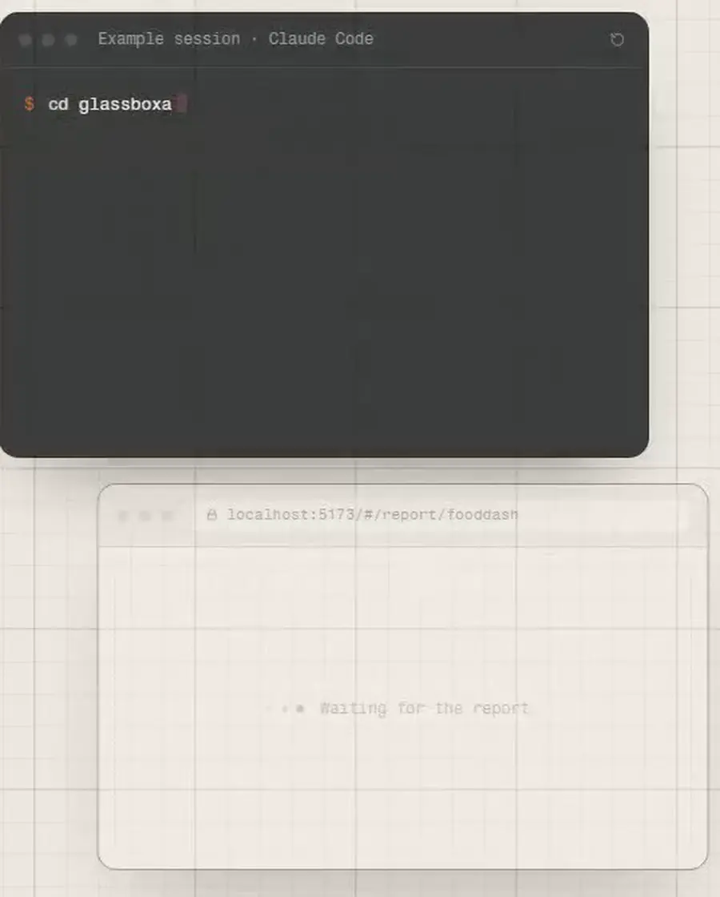</a>
</p>

<p align="center"><sub>▶ <a href="docs/readme/demo.mp4"><b>Watch it as MP4</b></a> · preview not moving? <a href="docs/readme/demo.gif">Open the GIF</a> · 🌐 <a href="https://glassboxapk.vercel.app"><b>glassboxapk.vercel.app</b></a></sub></p>

You add this repo to your AI coding agent. You drop an APK into `apks/` and say **"Analyze apks/your-app.apk"**. The agent decompiles it, traces every flow from an entry point to a goal, and opens an animated system design of the app in your browser.

### 🧊 The website: the glass box opens

<table>
  <tr>
    <td width="50%">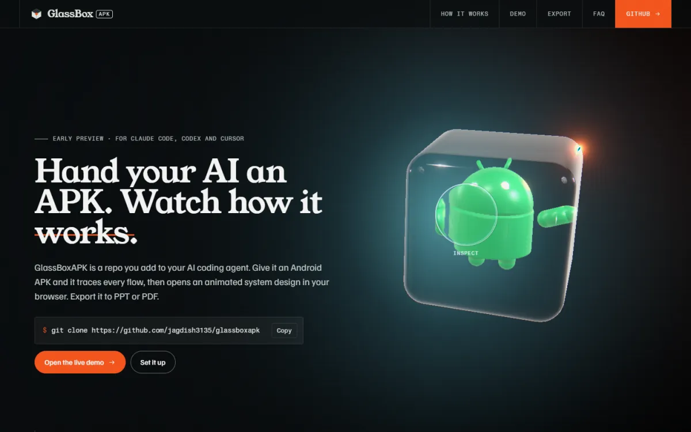</td>
    <td width="50%">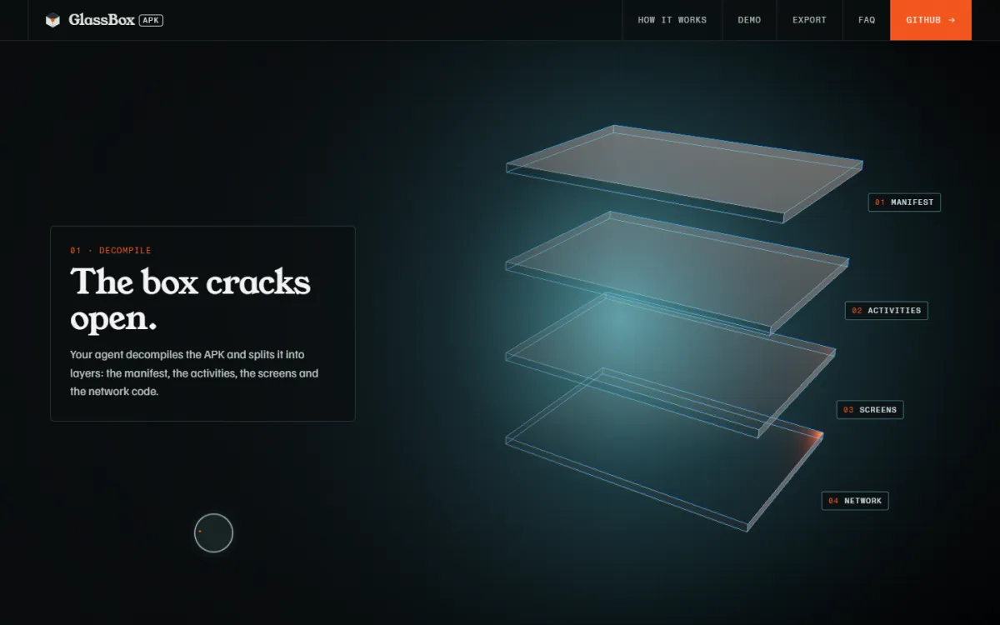</td>
  </tr>
  <tr>
    <td>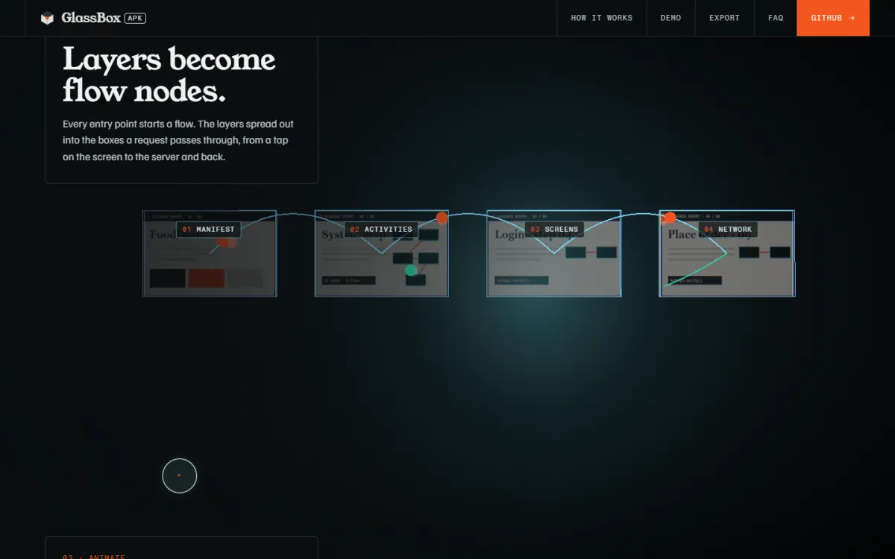</td>
    <td>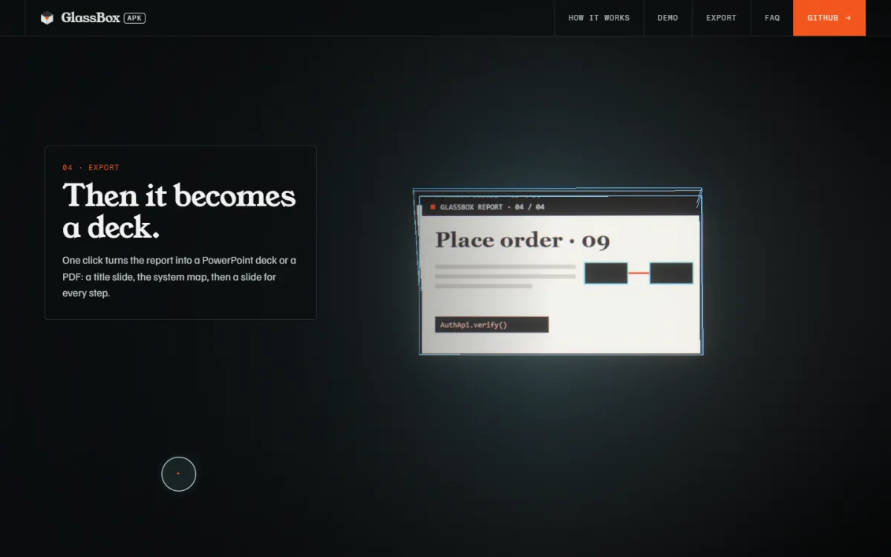</td>
  </tr>
</table>

[glassboxapk.vercel.app](https://glassboxapk.vercel.app) is a scroll story built with React Three Fiber, GSAP ScrollTrigger and Lenis. The hero model is made in Blender by [scripts/blender/glass_box.py](scripts/blender/glass_box.py). Hover the box and the cursor becomes a lens that zooms the 3D. With reduced motion, or without WebGL, the page shows a still render instead. Outside assets are listed in [CREDITS.md](CREDITS.md).

---

## ⚡ How it works

<p align="center">
  <picture>
    <source media="(prefers-color-scheme: dark)" srcset="docs/readme/how-it-works-dark.svg">
    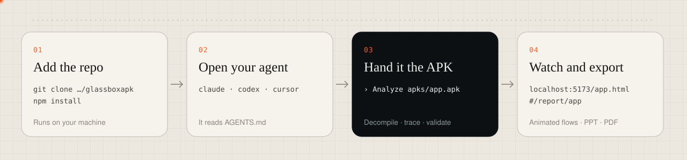
  </picture>
</p>

| | What happens | Where |
|:-:|---|---|
| 🧩 | **Decompile.** jadx turns the APK into readable code for the agent | `work/<name>/` (stays local) |
| 📋 | **Inventory.** Stack, SDKs, permissions, entry points, hosts, API paths, size | `reports/<name>.json` |
| 🔍 | **Trace.** Screen → ViewModel → repository → endpoint → response, storage writes, error branches | the agent, following [AGENTS.md](AGENTS.md) |
| ✅ | **Validate.** Checked against the report types; steps must point at real boxes; no source code allowed | `npm run validate-report` |
| 🌐 | **View.** The viewer opens the report and reloads when it changes | `localhost:5173/app.html#/report/<name>` |

---

## ▶️ The explainer

<p align="center">
  <a href="docs/readme/flow.mp4">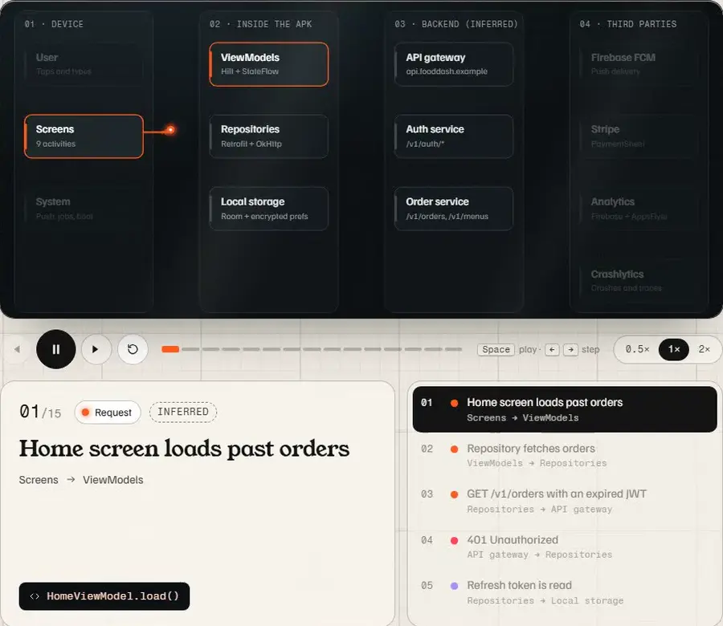</a>
</p>

Every flow plays step by step on the app's system map. The caption says what happens, and the code chip names the class, method or endpoint behind it.

| Colour | Means |
|---|---|
| 🟠 **Request** | a call or user action going out |
| 🟢 **Response** | data coming back |
| 🟣 **Storage** | something read from or written to the device |
| 🔴 **Error** | a failure path: 401s, timeouts, declined payments, offline fallbacks |

Flows are grouped into **happy paths**, **error and edge paths**, **background** jobs and **third-party** calls. Play, pause, step with <kbd>←</kbd> <kbd>→</kbd>, or change the speed.

<table>
  <tr>
    <td width="50%">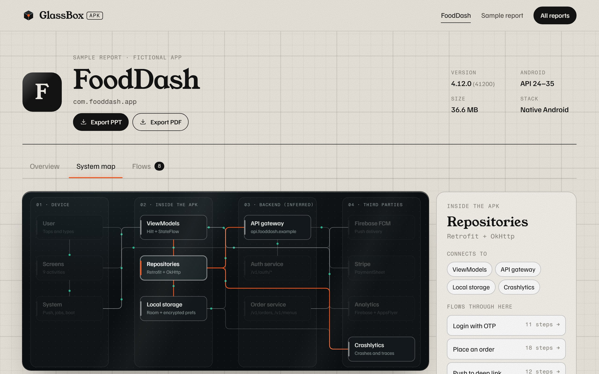</td>
    <td width="50%">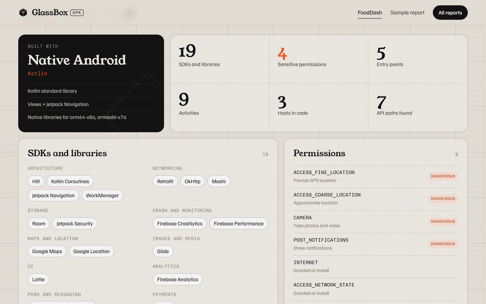</td>
  </tr>
  <tr>
    <td align="center"><b>🗺 System map</b><br><sub>Click a box to see its connections and the flows that pass through it</sub></td>
    <td align="center"><b>📋 Full inventory</b><br><sub>Stack, SDKs with evidence, permissions ranked by risk, entry points, network, size</sub></td>
  </tr>
</table>

---

## 📤 Export to PPT and PDF

<p align="center">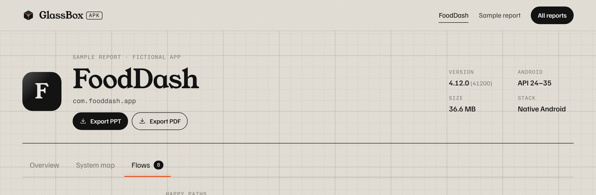</p>

Two buttons in every report header. Both run in your browser.

<table>
  <tr>
    <td width="33%">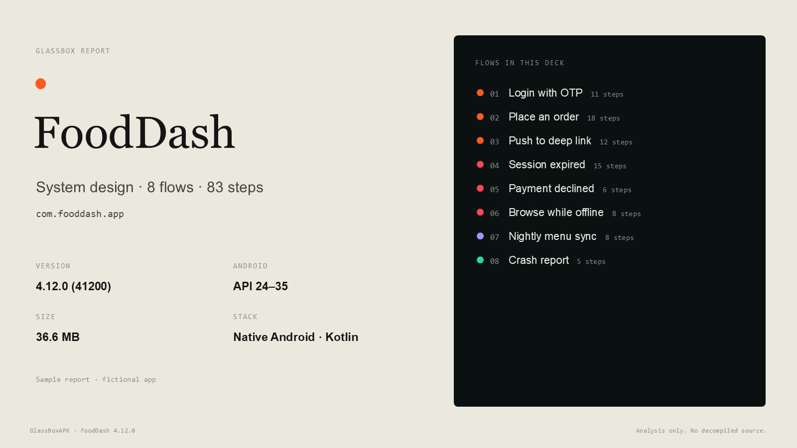</td>
    <td width="33%">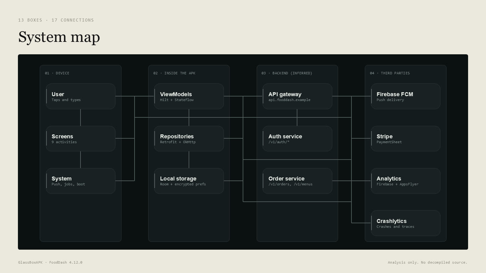</td>
    <td width="33%">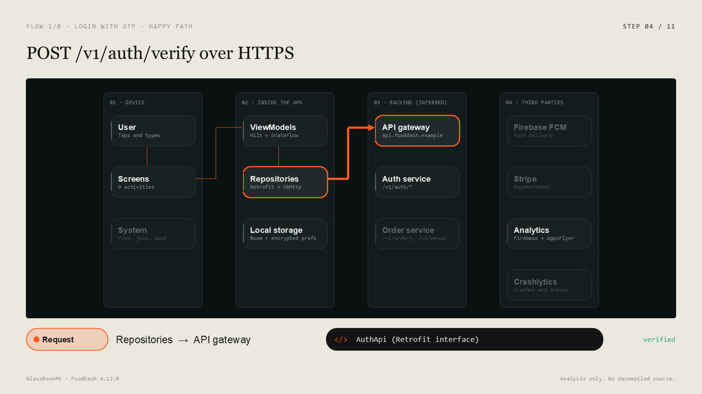</td>
  </tr>
  <tr>
    <td align="center"><sub>Title + flow list</sub></td>
    <td align="center"><sub>System map, drawn as shapes</sub></td>
    <td align="center"><sub>One slide per step: route, caption, code ref</sub></td>
  </tr>
</table>

**📊 PowerPoint** ([sample deck](docs/readme/fooddash-deck.pptx)): real text and shapes, so everything is editable. Speaker notes carry each step's details.

<table>
  <tr>
    <td width="50%">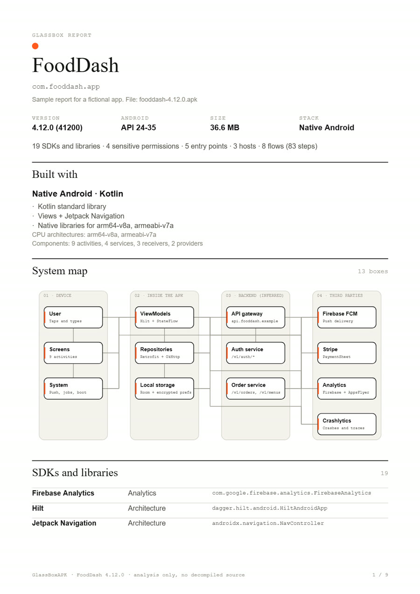</td>
    <td width="50%">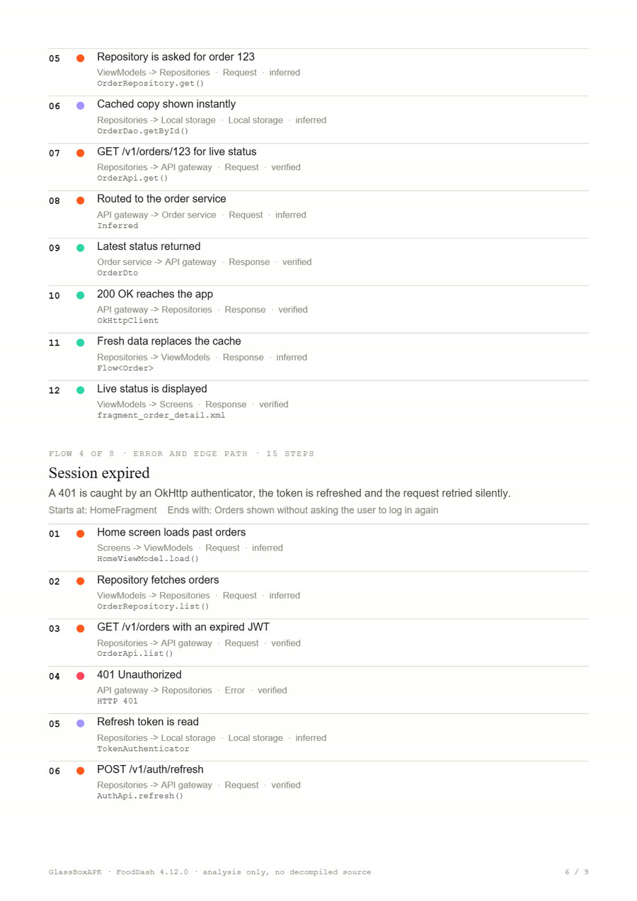</td>
  </tr>
</table>

**📄 PDF** ([sample report](docs/readme/fooddash-report.pdf)): stack, SDKs, permissions, entry points, network, size, the system map, and every flow as a numbered step list with its code references.

---

## 🚀 Quick start

You need **Git**, **Node.js 18+**, **Java 11+** and **[jadx](https://github.com/skylot/jadx/releases)**. `npm run decompile` tells you how to install anything that's missing.

```bash
git clone https://github.com/jagdish3135/glassboxapk
```

```bash
cd glassboxapk && npm install
```

Open the folder in your agent (`claude`, `codex`, or Cursor's agent chat), put an APK in `apks/`, and ask:

```
Analyze apks/your-app.apk
```

<details>
<summary><b>No APK to hand? Try the sample</b></summary>

```bash
npm run sample-report
```

```bash
npm run view fooddash
```

That writes the fictional FoodDash app to `reports/fooddash.json` and opens it.
</details>

---

## 🤖 What your agent runs

| Command | What it does |
|---|---|
| `npm run decompile apks/x.apk` | Checks Java and jadx (with install help), decompiles into `work/x/` |
| `npm run scan apks/x.apk` | Writes the inventory part of `reports/x.json` |
| `npm run validate-report reports/x.json` | Validates the report. Exit code 0 = valid |
| `npm run view x` | Starts the viewer (or reuses a running one), prints the URLs, opens the report |

The full method, with search patterns for endpoints, auth, storage, push and obfuscated code, is in **[AGENTS.md](AGENTS.md)**. Claude Code reads it through [CLAUDE.md](CLAUDE.md).

<details>
<summary><b>📁 Folders</b></summary>

| Folder | What goes there | In git? |
|---|---|---|
| `apks/` | The APKs you want to study | No (only its README) |
| `work/` | jadx output, for the agent to read | No |
| `reports/` | `<name>.json` reports, read by the viewer | No |
| `tools/` | Optional local jadx (`tools/jadx/bin/jadx`) | No |

`work/` and `reports/` are whitelisted in `.ignore`, so ripgrep-based search tools can still read them.
</details>

<details>
<summary><b>🛠 Development</b></summary>

| Command | What it does |
|---|---|
| `npm run dev` | Dev server |
| `npm run build` | Type check and build to `dist/` |
| `npm run serve` | Serve the production build |
| `npm test` | 49 checks: the APK scanner on a synthetic APK, the validator on good and broken reports, and both exports (files go to `test/out/`) |
| `npm run test:e2e` | Playwright check of the website at 1440 px and 390 px: loader, scroll story, cursor, the call to action into the viewer, and the reduced-motion poster. Add `-- --shots` to save screenshots to `test/out/landing/` |
| `node docs/readme/capture.mjs` | Re-capture the README screenshots and videos from a running viewer |
| `node docs/readme/make-svgs.mjs` | Regenerate the README banner and diagram |

```
AGENTS.md / CLAUDE.md   the analysis workflow
scripts/                decompile, scan, validate, view, reports dev-server plugin
src/types.ts            the Report / Flow / FlowStep contract
src/lib/validate.ts     report validator, typed against types.ts
src/lib/export/         PPTX (pptxgenjs) and PDF (jsPDF) builders
src/components/         FlowPlayer, SystemMap, Overview
src/landing/            the website
```
</details>

---

## ❓ FAQ

<details>
<summary><b>Does my APK get uploaded anywhere?</b></summary>

No. GlassBoxAPK has no server. The APK, the decompiled code and the report stay in your local copy of the repo, and the viewer runs on localhost. Your AI agent sends the code it reads to its own model provider, as with any coding task.
</details>

<details>
<summary><b>Which apps work best?</b></summary>

Native Kotlin and Java apps give the most detail, even when obfuscated. Flutter and React Native apps work with less detail, because their logic ships as compiled Dart or JavaScript bytecode.
</details>

<details>
<summary><b>What does "inferred" mean on a step?</b></summary>

The step was found by reading the code, not observed while the app ran. Every step an agent traces statically is marked inferred.
</details>

<details>
<summary><b>Does the report contain the app's code?</b></summary>

No. A report holds descriptions and references (class, method, file and endpoint names). The validator rejects anything that looks like source code.
</details>

---

<p align="center"><sub>Built for studying how apps are designed. GlassBox shows analysis, never decompiled source.</sub></p>
